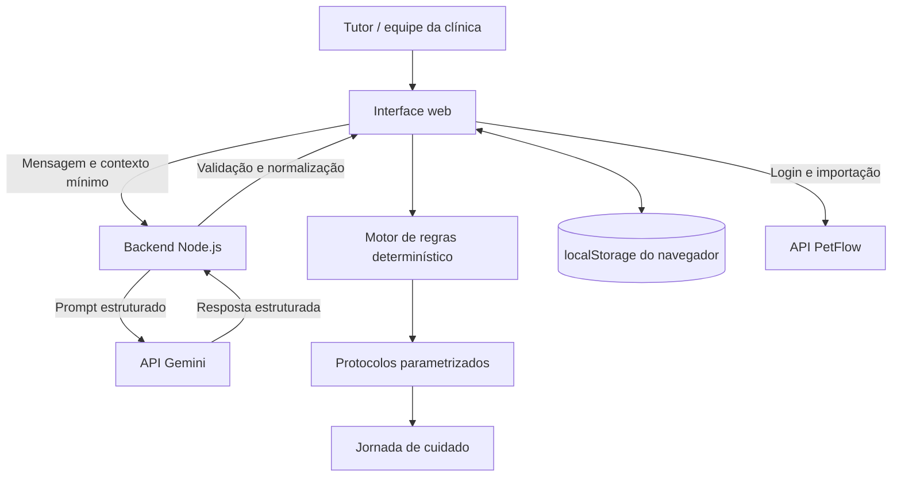

# Arquitetura — CLYVO VET Sprint 4

## Visão geral

O CLYVO VET combina interpretação de linguagem natural por IA generativa com regras determinísticas de cuidado. A IA ajuda a interpretar a mensagem do tutor e sugerir uma categoria; ela não diagnostica, prescreve medicamentos ou substitui o médico-veterinário.

## Fluxo implementado

1. O tutor ou operador informa uma mensagem e, quando disponível, seleciona o pet relacionado.
2. O frontend envia a mensagem ao endpoint `/api/ai/interpret` do backend Node.js.
3. O backend utiliza a chave `GEMINI_API_KEY`, configurada no ambiente do servidor, para acessar o Gemini. A chave não deve ser exposta no navegador nem versionada no repositório.
4. A resposta da IA é validada e normalizada pelo backend antes de retornar ao frontend.
5. O frontend combina a interpretação com critérios e protocolos determinísticos para exibir recomendações explicáveis.
6. Quando a mensagem exige avaliação profissional, a interface pausa a criação automática de ações na jornada e orienta o encaminhamento ao médico-veterinário.
7. Os registros locais da demonstração e da jornada são mantidos no `localStorage` do navegador.
8. A integração PetFlow permite autenticação e importação de dados de pets conforme as credenciais e a disponibilidade do serviço.

## Dados utilizados

A interpretação pode considerar a mensagem do tutor e o contexto mínimo do pet disponibilizado pelo fluxo da aplicação, como identificação e espécie. Devem ser enviados apenas os dados necessários à finalidade da análise. Não inclua segredos, tokens ou dados pessoais desnecessários no prompt.

## Estratégia de personalização

A personalização depende do contexto do pet e dos dados selecionados na interface. A IA interpreta a linguagem natural; a seleção de protocolos e prazos permanece baseada em regras explícitas e verificáveis da aplicação. A demonstração deve deixar claro o motivo da recomendação e a categoria associada.

## Segurança e limites

- A chave Gemini fica no backend, em variável de ambiente.
- A resposta externa deve ser validada antes de ser usada pela interface.
- Mensagens que demandam avaliação veterinária não devem gerar ações preventivas automaticamente.
- Protocolos exibidos são apoio organizacional e educativo, não diagnóstico nem prescrição.
- O `localStorage` é armazenamento local do navegador; não equivale a um banco multiusuário ou sincronização entre clínicas.
- A integração real com Gemini e PetFlow depende de credenciais válidas e deve ser testada no ambiente de execução.

## Configuração local

Copie `.env.example` para `.env` e preencha as variáveis necessárias no ambiente local. Não faça commit do arquivo `.env`. Instale as dependências com `npm install`, execute os testes com `npm test` e inicie o serviço conforme os scripts definidos no `package.json`.
